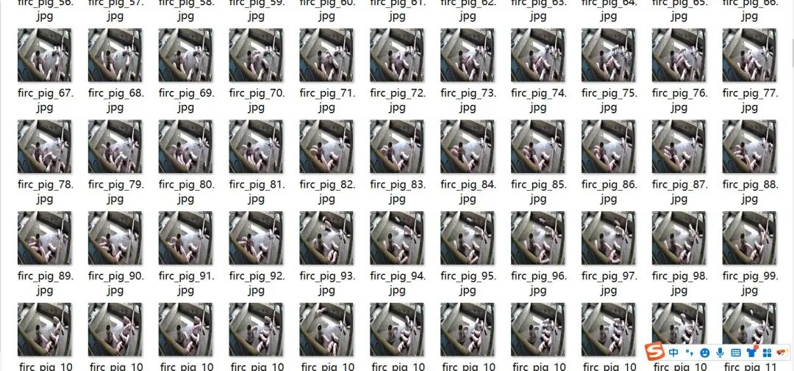
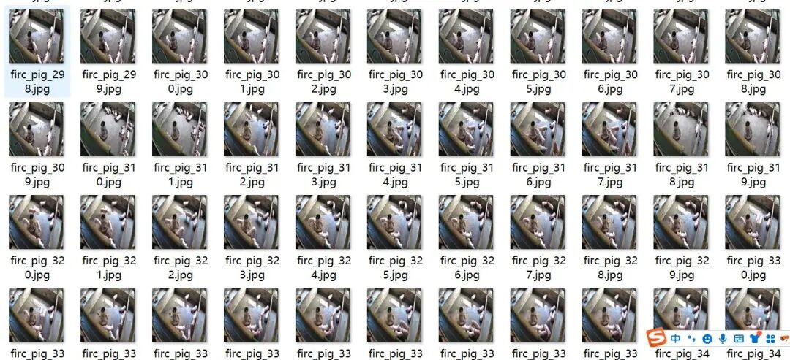
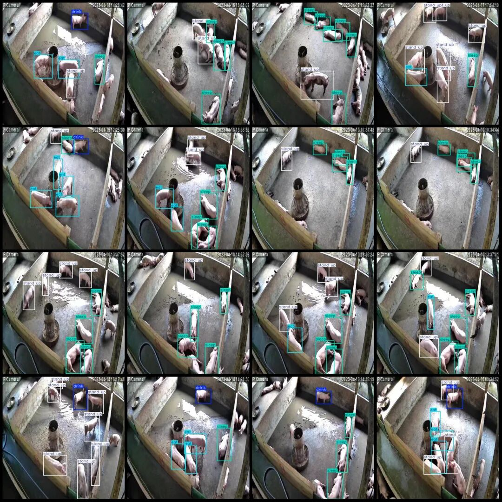

# Dataset for Animal Behaviour Identification in Pig Pens: 630 Images of 4 Categories

Dataset format: Pascal VOC format + YOLO format (txt file without split path, only containing jpg images and corresponding VOC format xml files and yolo format txt files)

Number of images (number of jpg files): 630

Number of annotations (number of xml files): 630

Number of annotations (number of txt files): 630

Labeling category count: 4

Label category names (note that the order of yolo format categories does not correspond to this, but is based on the classes.txt in the labels folder): ["drink", "eat", "sleep", "stand up"]

Number of boxes labeled in each category:

Drink Frames = 251

Number of "eat" boxes = 736

Sleep Frames = 1930

Stand up Frames = 1086

Total frame count: 4003

Image resolution: 640x640

Using labelImg:

Annotation rules: Draw a rectangle around the category.

Important Notice: No

Special : This dataset does not guarantee the accuracy of the trained models or weight files.

Image Preview:

Annotation example:

## Payment

Here is a pay link on Stripe ( https://buy.stripe.com/3cs8yP7sY87d0vu9AB ). Please contact me lonlonago@foxmail.com after funding $89, and I will send you a complete data files , thank you!

